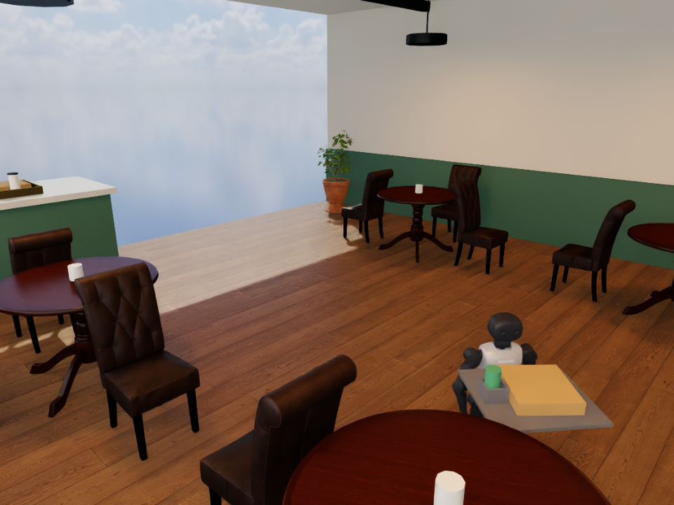
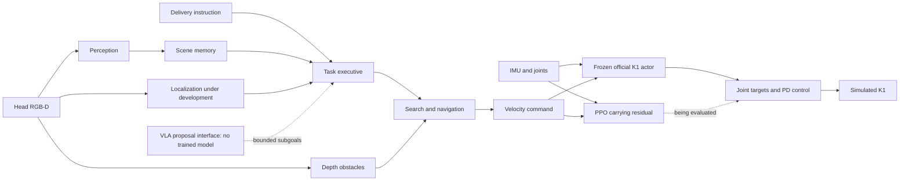

# K1 meal delivery

A Booster K1 simulation project working toward vision-guided delivery of a pizza
box and drink. The system combines RGB-D perception, explicit scene memory,
search/navigation, a pretrained walking policy and a newly trained PPO carrying
residual. Physical robot performance is not yet verified.



*Actual final frame: PPO residual plus an explicit cup holder completed a
15-second, 3.56-metre scripted carrying trial within the current stability limits.
The tray is attached to a modeled torso bracket. This is one simulation trial;
camera-guided delivery remains unfinished.
[Measured result and limitations](experiments/codex-20261017T2150-k1-appearance-repeat/REPORT.md).*


*RTX café preview with Poly Haven CC0 furniture, materials and lighting assets.
No robot is present in this environment-preview frame.*

## Measured progress

| Component | Current evidence |
| --- | --- |
| Unloaded K1 walking in Isaac | [15 s, 2.92 m forward, 4.37° peak tilt, no fall](experiments/codex-20261017T2035-k1-isaac-walk-corrected/REPORT.md); corrected 19.666 kg model, scripted commands |
| Camera → autonomy → walking in MuJoCo | [Two completed diagnostic approaches and one stalled trial](experiments/claude-20261017T2008Z-k1-camera-autonomy-diagnostic/REPORT.md); privileged localization, numbered signs, no payload |
| Table detection in the realistic café | [3/4 targets detected in six offline RGB-D captures](experiments/claude-20261017T2023Z-cafe-tabletop-offline/REPORT.md); known missed table and counter/payload mislabel retained |
| Supported tray + free box/drink | [Drink dropped at 6.442 s](experiments/codex-20261017T2043-k1-loaded-baseline/REPORT.md); robot remained upright |
| Real PPO updates | [204,800 physics transitions, 1,600 optimizer updates](experiments/codex-20261017T2054-ppo-training/REPORT.md); new residual weights changed, original actor frozen |
| First trained café comparison | [3.23 m before drink drop vs 1.25 m baseline](experiments/codex-20261017T2055-ppo-cafe-evaluation/REPORT.md); both failed, one development pair |
| Cup-holder fixture + trained residual | [15 s, 3.56 m, no drops, 3.31 cm maximum payload movement](experiments/codex-20261017T2124-cupholder-ppo-transfer/REPORT.md); one scripted stability pass. Same-fixture baseline failed the 4 cm movement limit |
| Memory, search, obstacle handling, bounded VLA interface | Software-tested components; see [autonomy design](docs/autonomy/DESIGN.md) |
| Sensor-estimated navigation | [One unloaded approach completed in 19 s](experiments/codex-20261017T2152-sensor-navigation-surface-fix/REPORT.md); no markers or simulator pose input to navigation, 9.74 cm maximum XY error, 0.00124 m/s final true speed |
| SmolVLA GPU compatibility | [Pinned checkpoint loaded; custom inputs and backward pass verified](experiments/codex-20261017T2155-smolvla-probe/REPORT.md); synthetic probe, zero optimizer updates |
| VLA fine-tuning and hardware delivery | Not completed |

These results are separate experiments. An integrated, learned, camera-guided
loaded delivery has not yet been demonstrated. Simulator-only inputs are labeled
and kept out of deployment policy observations. Raw recordings and weights stay
outside Git; reports retain hashes, provenance and storage references.

## Architecture



The executive owns task completion and rejects invalid or stale action proposals.
The VLA interface is implemented; no VLA training is implied by its presence.
The PPO residual uses joint/IMU/command signals. True simulated velocity and
payload state affect training rewards, not actor observations.

[System architecture](docs/ARCHITECTURE.md) · [Autonomy contracts](docs/autonomy/CONTRACTS.md) ·
[Carrying training](training/CARRYING_PLAN.md) · [Evaluation protocol](docs/EVALUATION.md)

## Reproduce

Use [sim/README.md](sim/README.md) for pinned Booster assets and the isolated
MuJoCo environment, and [sim/CAFE.md](sim/CAFE.md) for the Isaac café. GPU jobs use
the recorded source/config hashes in each experiment manifest.

```sh
# Create this environment only if it does not already exist.
uv venv --python 3.12 .venv
uv pip install --python .venv/bin/python -r requirements-dev.txt
.venv/bin/python -m pytest tests/autonomy -q -p no:cacheprovider
python3 -m unittest discover -s tests/integration -v
python3 -m unittest discover -s tests/evaluation -v
```

The shell's Python may differ from the project environments. Do not recreate an
environment another process is using. A successful software test is not a robot
performance result.

## Development

Codex handles simulation, control, training, evaluation and Git integration;
Claude handles perception, memory, navigation and the VLA interface. Shared work
uses explicit path ownership and reviewed Markdown handoffs.

[Goal](GOAL.md) · [Roadmap](docs/ROADMAP.md) · [Team rules](AGENTS.md) ·
[Codex status](coordination/CODEX_STATUS.md) · [Claude status](coordination/CLAUDE_STATUS.md)

Robot assets and base policy: BoosterRobotics, pinned in
[sim/upstream-lock.json](sim/upstream-lock.json). Café assets: Poly Haven, CC0.
Tools and infrastructure: NVIDIA Isaac Sim/Isaac Lab, Crusoe GPU through Brev,
and You.com research. Large recordings and trained weights are excluded from Git.
