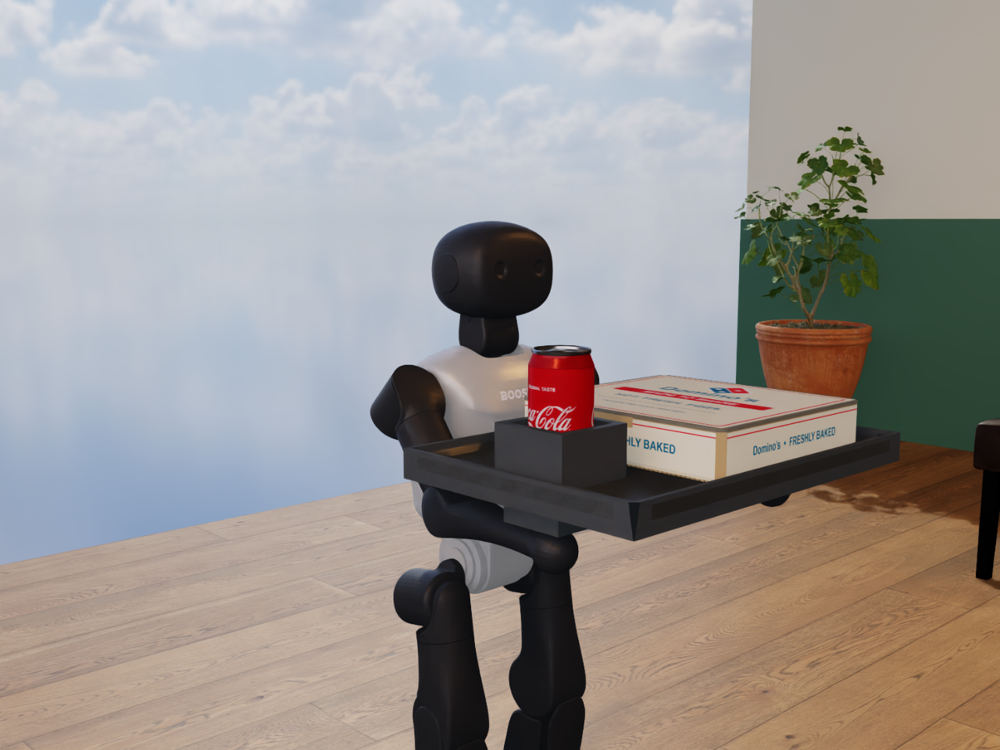
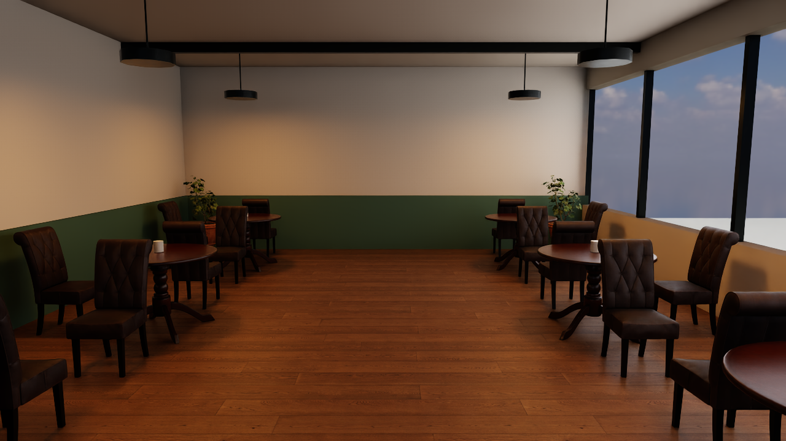
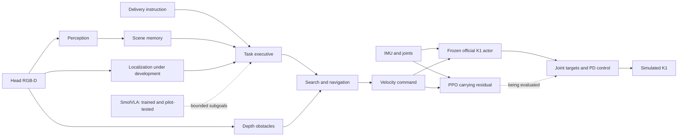

# Tableside — K1 meal delivery

A Booster K1 simulation project working toward vision-guided delivery of a pizza
box and drink. The system combines RGB-D perception, explicit scene memory,
search/navigation, a pretrained walking policy and a newly trained PPO carrying
residual. Physical robot performance is not yet verified.



*Actual Isaac render: a free tray rests on physical hand contacts, with a pizza
box and sealed Coke can. A 15-second scripted carry covered 2.19 m with no drop
and 8 mm maximum payload movement. This hand-contact baseline uses arm torque
control and the frozen walking actor; PPO/VLA and camera guidance are separate
experiments. [Physics and measured result](experiments/codex-20261017T2305-hand-carry-isaac/REPORT.md).*



*RTX café preview with Poly Haven CC0 furniture, materials and lighting assets.
No robot is present in this environment-preview frame.*

## Measured progress

| Component | Current evidence |
| --- | --- |
| Unloaded K1 walking in Isaac | [15 s, 2.92 m forward, 4.37° peak tilt, no fall](experiments/codex-20261017T2035-k1-isaac-walk-corrected/REPORT.md); corrected 19.666 kg model, scripted commands |
| Camera → autonomy → walking in MuJoCo | [Two completed diagnostic approaches and one stalled trial](experiments/claude-20261017T2008Z-k1-camera-autonomy-diagnostic/REPORT.md); privileged localization, numbered signs, no payload |
| Table detection in the realistic café | [3/4 targets detected in six offline RGB-D captures](experiments/claude-20261017T2023Z-cafe-tabletop-offline/REPORT.md); known missed table and counter/payload mislabel retained |
| Supported tray + free box/drink | [Drink dropped at 6.442 s](experiments/codex-20261017T2043-k1-loaded-baseline/REPORT.md); robot remained upright |
| Real PPO updates | [204,800 physics transitions, 1,600 optimizer updates](experiments/codex-20261017T2054-ppo-training/REPORT.md); new residual weights changed, original actor frozen |
| First trained café comparison | [3.23 m before drink drop vs 1.25 m baseline](experiments/codex-20261017T2055-ppo-cafe-evaluation/REPORT.md); both failed, one development pair |
| Cup-holder fixture + trained residual | [15 s, 3.56 m, no drops, 3.31 cm maximum payload movement](experiments/codex-20261017T2124-cupholder-ppo-transfer/REPORT.md); one scripted stability pass. Same-fixture baseline failed the 4 cm movement limit |
| Memory, search, obstacle handling, bounded VLA interface | Software-tested components; see [autonomy design](docs/autonomy/DESIGN.md) |
| Sensor-estimated navigation | [One unloaded approach completed in 19 s](experiments/codex-20261017T2152-sensor-navigation-surface-fix/REPORT.md); no markers or simulator pose input to navigation, 9.74 cm maximum XY error, 0.00124 m/s final true speed |
| Varied sensor-guided teacher collection | [4 completed / 10 unloaded attempts](experiments/codex-20261017T2210-sensor-demo-pilot/REPORT.md); six timeouts, one contact trial, translation drift remains a major limitation |
| SmolVLA fine-tuning | [200 actual optimizer updates](experiments/codex-20261017T2215-smolvla-training/REPORT.md); three training episodes, one validation episode, frozen backbone unchanged; offline imitation only |
| SmolVLA closed-loop comparison | [Executive2/4; trainedVLA2/4](experiments/codex-20261017T2230-vla-closed-loop/REPORT.md); eight unloaded simulator runs, no overall improvement |
| GR00T N1.7 pilot | [20 actual updates and saved-checkpoint inference](experiments/codex-20261017T2245-groot-pilot/REPORT.md); closed-loop performance unmeasured |
| Free tray supported in both hands | [MuJoCo:15s,2.036m,3.295mm shift](experiments/codex-20261017T2300-hand-carry/REPORT.md); [Isaac café:15s,2.193m,8.038mm shift](experiments/codex-20261017T2305-hand-carry-isaac/REPORT.md); no torso support/weld, scripted baseline without PPO/VLA |
| Camera-guided delivery with a hand-supported load | [Delivered in22.8s plus2s settling](experiments/codex-20261017T2310-loaded-navigation/REPORT.md); no collision/drop/fall,3.8mm payload shift; one development configuration, no VLA/PPO |
| GR00T longer fine-tuning | [500 actual updates and strict saved-checkpoint reload](experiments/codex-20261017T2320-groot-curve/REPORT.md); first run validation1.765→2.451 (worse); [complete-logging repeat](experiments/codex-20261017T2320-groot-curve/attempt03/REPORT.md)1.765→1.371 (lower); no reproducible delivery benefit established |
| Varied loaded delivery | [3/4 prospective start/target conditions](experiments/codex-20261017T2340-loaded-variation/REPORT.md); one timeout with wall contact and brief non-hand support |
| Printed payload and physical table | [Delivered65.6s+2s settling in longer diagnostic](experiments/codex-20261017T2345-printed-navigation/REPORT.md); original60s attempt timed out |
| Loaded turning | [Unintended translation during pure-yaw commands](experiments/codex-20261017T2350-hand-turn-probe/REPORT.md); carrying-controller weakness remains |
| GR00T loaded comparison | [3/4 with GR00T;3/4 executive-only](experiments/codex-20261017T2355-groot-loaded/REPORT.md); remote latency rejected many proposals, no overall improvement |
| GR00T with lossless image transport | [2/4 versus baseline3/4](experiments/codex-20261017T2355-groot-loaded/png/REPORT.md); greater proposal participation did not improve delivery |
| PPO for hand-supported carrying | [32,768 real control steps;1,024 updates](experiments/codex-20261018T0000-hand-ppo/REPORT.md); matched diagnostics regressed to3/8 versus baseline4/8, not promoted |
| Interactive Isaac desktop | [Live café with GR00T selector and Start/Pause/Reset](docs/hardware/ISAAC_LIVE.md); real head-camera proposals drive the baseline gait; experimental transfer, first longer run fell at 9.284s |
| Hardware delivery | Not completed |

An integrated camera-guided loaded delivery now passes in one MuJoCo development
configuration. Four further loaded configurations passed3/4. Learned hand-carry control and broad reliability remain
unverified; the PPO and VLA results above are separate experiments. Simulator-only inputs are labeled
and kept out of deployment policy observations. Raw recordings and weights stay
outside Git; reports retain hashes, provenance and storage references.

## Architecture



The executive owns task completion and rejects invalid or stale action proposals.
The bounded SmolVLA adapter has been tested in eight unloaded simulator runs:
2/4 passes per mode, with no overall improvement over executive-only control.
The PPO residual uses joint/IMU/command signals. True simulated velocity and
payload state affect training rewards, not actor observations.

[System architecture](docs/ARCHITECTURE.md) · [Autonomy contracts](docs/autonomy/CONTRACTS.md) ·
[Carrying training](training/CARRYING_PLAN.md) · [Evaluation protocol](docs/EVALUATION.md)

## Done Means Done: verification agent

Tableside's submission track is **Done Means Done**. The [verifier](agents/verifier.py)
rechecks claimed file hashes, allowlisted test commands and evidence paths, then asks
a Nemotron judge on Crusoe Managed Inference to assess the claims. Failed checks force
FAIL; missing checks or failed model calls cannot produce PASS. Repeated failures
trigger a replan signal. The verifier records verdicts and reasons for review.

**Live on Crusoe Managed Inference** (`nvidia/NVIDIA-Nemotron-3.5-Super-VL`, auto-selected from
`/v1/models`), recorded runs on 2026-10-18:

| Handoff checked | Verdict | What happened |
| --- | --- | --- |
| CL-13 v2, first live attempt | **INCOMPLETE** | Nemotron used its whole 2000-token budget on reasoning and returned no answer. The verifier refused to PASS on missing extraction, and that exposed the bug. ([run](coordination/verifier_runs/2026-10-18T001533+0000.json)) |
| CL-15 (current fix) | **PASS** | 2/2 hashes match; the test command was actually run (15 passed, as claimed); the evidence exists. ([run](coordination/verifier_runs/2026-10-18T001704+0000.json)) |
| CL-13 v2, rerun after code changed | **FAIL** | Two stale hashes; the claim "14 passed" vs the real 15. Nemotron flagged it as an overclaim, and the loop guard asked for a retry. ([run](coordination/verifier_runs/2026-10-18T001752+0000.json)) |

`.venv/bin/python -m pytest tests/agents -q -p no:cacheprovider` gives 15 tests (fake model).
Run it live: put `CRUSOE_API_KEY` in `.env`, then run
`.venv/bin/python -m agents.verifier --handoff coordination/CLAUDE_HANDOFF.md`. The verifier
checks engineering handoffs and does not measure robot performance. The live Isaac desktop and
model training use the separate Crusoe GPU VM through Brev.

[Interactive demo instructions](demo/LIVE_DEMO.md) cover the local sensor-guided
MuJoCo viewer and browser-connected Isaac café. The Isaac panel selects GR00T
camera-guided proposals or baseline straight walking. Both use the baseline gait;
hand-PPO is not enabled in the live launch. See the [Isaac controls and limitations](docs/hardware/ISAAC_LIVE.md).

## Reproduce

Use [sim/README.md](sim/README.md) for pinned Booster assets and the isolated
MuJoCo environment, and [sim/CAFE.md](sim/CAFE.md) for the Isaac café. GPU jobs use
the recorded source/config hashes in each experiment manifest.

```sh
# Create this environment only if it does not already exist.
uv venv --python 3.12 .venv
uv pip install --python .venv/bin/python -r requirements-dev.txt
.venv/bin/python -m pytest tests/autonomy -q -p no:cacheprovider
python3 -m unittest discover -s tests/integration -v
python3 -m unittest discover -s tests/evaluation -v
```

The shell's Python may differ from the project environments. Do not recreate an
environment another process is using. A successful software test is not a robot
performance result.

## Development

Codex handles simulation, control, training, evaluation and Git integration;
Claude handles perception, memory, navigation and the VLA interface. Shared work
uses explicit path ownership and reviewed Markdown handoffs.

[Goal](GOAL.md) · [Roadmap](docs/ROADMAP.md) · [Team rules](AGENTS.md) ·
[Codex status](coordination/CODEX_STATUS.md) · [Claude status](coordination/CLAUDE_STATUS.md)

Robot assets and base policy: BoosterRobotics, pinned in
[sim/upstream-lock.json](sim/upstream-lock.json). Café assets: Poly Haven, CC0.
Tools and infrastructure: NVIDIA Isaac Sim/Isaac Lab, Crusoe GPU through Brev,
and You.com research. Large recordings and trained weights are excluded from Git.
