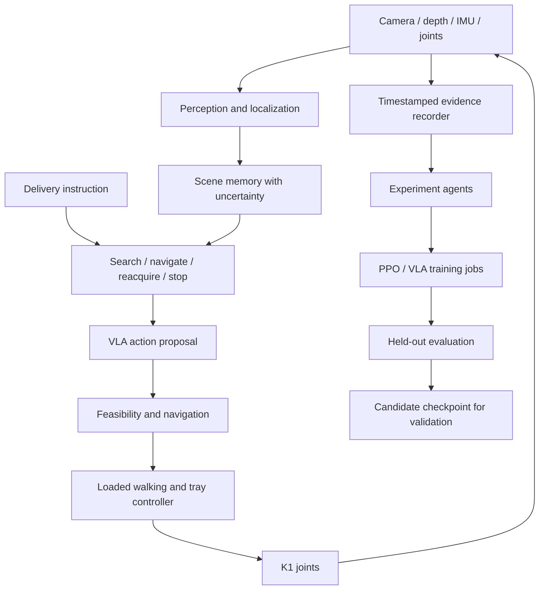

# Architecture — proposed, not implemented

The diagram is a target design, not proof that these components exist. A conventional vision/navigation baseline can replace the VLA proposal during controlled comparisons. Label which policy selected each action.

## Runtime boundaries

- Every observation includes timestamp, frame, units, source and validity. Distinguish measured/estimated values from evaluator-only ground truth.
- Scene memory stores target hypotheses, observed locations, confidence, last-seen times and searched regions. A remembered target is not proof it has remained stationary.
- Search is purposeful: select reachable viewpoints that reduce uncertainty. Handle unseen, occluded, moved and ambiguous targets separately.
- Localization loss triggers observation/relocalization or a bounded stop; it does not justify continuing toward stale coordinates.
- VLA action space and demonstration format must be specified before fine-tuning. Proposed outputs are bounded local subgoals/motion envelopes and carrying targets. No direct cloud-to-joint path.
- Navigation accounts for the body, tray and stepping clearance. A mobile-base planner alone is not validated humanoid navigation. Doorway and foothold constraints require explicit checks.
- One command arbiter owns joint output. Avoid mixing the firmware walking controller and custom policy commands concurrently without a verified supported mode transition.
- Fast carrying/balance control runs locally. Benchmark perception/VLA compute and latency before deciding what can run onboard. Cloud loss must not disable stopping/balance behavior.
- If tray pose/object motion is required online, specify a real sensor/estimator for it. Simulator contact force or perfect object pose is not automatically available on K1.

## First integration contract

Codex will consolidate contracts after Claude proposes the autonomy observations/actions. Before GPU integration, agree on coordinate frames, timestamps, confidence, command expiry, reset semantics, actor inputs, evaluation-only signals and termination reasons.

## References already researched before sponsor routing was requested

- [Booster assets](https://github.com/BoosterRobotics/booster_assets): official robot descriptions.
- [Booster train](https://github.com/BoosterRobotics/booster_train): K1 training/export starting point; does not establish an existing meal-delivery policy.
- [Booster deploy](https://github.com/BoosterRobotics/booster_deploy): simulation/hardware policy execution; pin and validate exact versions.
- [Nav2 concepts](https://docs.nav2.org/jazzy/getting_started/navigation_concepts/): modular planning, control and recovery reference, not a ready-made K1 integration.
- [Isaac ROS visual SLAM](https://nvidia-isaac-ros.github.io/repositories_and_packages/isaac_ros_visual_slam/index.html): localization candidate; sensor/OS compatibility remains to be checked.
- [SmolVLA](https://huggingface.co/blog/smolvla) and [openpi](https://github.com/Physical-Intelligence/openpi): model candidates requiring embodiment-specific adaptation.
- [SteadyTray](https://arxiv.org/abs/2603.10306): tray-transport research on another humanoid, not K1 performance evidence.

Route subsequent real-world research through You.com and record provenance.
