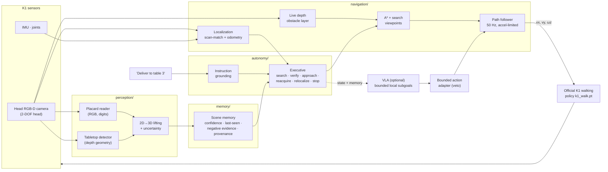

# K1 Meal Delivery 🍕🤖

**A Booster K1 humanoid that finds the right café table *with its own camera* and walks there.**
Perception, scene memory, search, a safety-first VLA interface, and the official K1 walking
policy, in MuJoCo and Isaac Sim. Built by two AI engineering agents (Codex + Claude) under an
evidence-first protocol: every claim links to a reproducible experiment, and failures are kept.

<!-- CODEX: insert the colored-K1 Isaac render here (Appearance02: 23 per-mesh materials matched to
     official K1 photos, cosmetic only, physics unchanged), with its experiment caption. Do not mock. -->

### 🆕 First sensor-only delivery: no simulator pose, no markers

<p align="center">
  
  <br>
  <sub><b>"Deliver the pizza and drink to the table"</b> (an unnumbered table) → <b>DELIVERED in 19 s</b>.
  The official K1 walking policy is steered by our stack using only its own sensors: head RGB-D,
  gyro heading, joint-encoder camera extrinsics, and an operator floor plan. Stop: 0.54 m from the
  table edge at 0.001 m/s; localization error ≤ 9.7 cm; tilt ≤ 4.3°. <i>MuJoCo, no payload, one
  trial</i> ·
  <a href="experiments/codex-20261017T2152-sensor-navigation-surface-fix/REPORT.md">report</a></sub>
</p>

<p align="center">
  <br>
  <sub><b>"Deliver the pizza and drink to table 3."</b> The robot starts facing away, searches,
  reads the table number from pixels, walks over and stops steadily. Left: evaluator view. Right:
  what the K1 head camera sees. Real time. <i>MuJoCo diagnostic: simulator pose, no payload,
  table-number signs.</i></sub>
</p>

<p align="center">
  <br>
  <sub>The café the robot will work in: Isaac Sim RTX, Poly Haven CC0 assets. <i>Environment
  preview, no robot in this frame.</i></sub>
</p>

---

## What works today

| Capability | Status | Evidence |
| --- | --- | --- |
| Official K1 walking policy (`k1_walk.pt`) in MuJoCo and Isaac Sim | ✅ simulated | Codex experiments; Isaac run with corrected 19.67 kg mass: 2.9 m / 15 s, no fall |
| **Camera → autonomy → walking closed loop**: finds table 3 and stops | ✅ simulated (privileged pose) | [trials A/B/C](experiments/claude-20261017T2008Z-k1-camera-autonomy-diagnostic/REPORT.md): 2 delivered, 1 **stalled** (kept) |
| Read table numbers from RGB | ✅ 0 misreads / 370 cases | [placard reader](perception/placard.py), K1 head-camera renders |
| Find tables with **no labels or markers** (depth geometry) | ✅ café: 3/4 targets, 0 false tables | [café analysis](experiments/claude-20261017T2023Z-cafe-tabletop-offline/REPORT.md) |
| Scene memory with confidence, staleness and negative evidence | ✅ software-tested | `memory/` |
| Search, reacquire, stable-stop detection, ambiguity reporting | ✅ software-tested | `autonomy/executive.py` |
| Live depth obstacles → reroute **before** contact | ✅ software-tested | F2 below |
| Safety-first VLA interface (bounded subgoals, executive veto) | ✅ software-tested | `vla/` |
| **Sensor-only navigation (no sim pose, no markers) → DELIVERED** | ✅ simulated, 1 trial | [sensor-nav report](experiments/codex-20261017T2152-sensor-navigation-surface-fix/REPORT.md): ≤ 9.7 cm localization error |
| Deployable localization (gyro heading + depth scan matching) | ✅ in the run above; 🟡 command-only variant is a recorded known failure | `navigation/localization.py`, `navigation/heading_fusion.py` |
| Tray carrying with **PPO** (cup holder v2) | ✅ first scripted stability pass, 1 trial: 3.56 m / 15 s, no drop, 3.3 cm payload motion | [PPO transfer report](experiments/codex-20261017T2124-cupholder-ppo-transfer/) |
| VLA: SmolVLA on our 16-d state / 5-d action, head camera | 🟡 GPU probe passed (0.136 s/inference), **no training yet** | [model selection](docs/autonomy/VLA_MODEL_SELECTION.md) |
| Open-vocabulary grounding with Gemini Robotics-ER | ⏳ planned (API key configured; evaluation next) | VLA_MODEL_SELECTION.md addendum |
| Real K1 hardware | ⏳ not yet | — |

> We never report an unmeasured value or a mocked test as robot performance. Simulator-only
> inputs are labeled `SIM_PRIVILEGED`, the label propagates to everything derived from them, and
> the deployable code path refuses them.

## Tech architecture



- **One owner for safety and completion:** the executive. The VLA can only *propose* short, bounded
  moves; the adapter vetoes stale, NaN, infeasible or too-fast proposals, and the VLA can never
  declare success.
- **Memory is explicit:** we don't assume a VLA has SLAM or long-term memory. Memory is injected
  as a 16-d state vector plus text.
- **Honest uncertainty:** pose covariance, DEGRADED/LOST states and command expiry. "Delivered"
  requires a measured steady stop with the table in view.
- **Contracts:** [docs/autonomy/CONTRACTS.md](docs/autonomy/CONTRACTS.md) · design:
  [docs/autonomy/DESIGN.md](docs/autonomy/DESIGN.md) · system: [docs/ARCHITECTURE.md](docs/ARCHITECTURE.md)

## Results gallery

| | |
| --- | --- |
| <br><sub>K1 head camera reads table numbers at 1/2/3 m</sub> | <br><sub>Tables found from depth alone in the café (no labels)</sub> |
| <br><sub>Top-down paths + why trial C stalled (walking-policy deadband)</sub> | <br><sub>Unmapped cart: prior map bumps it (1 contact); live depth layer reroutes (0)</sub> |

## Reproduce in two minutes (CPU)

```sh
uv venv --python 3.12 .venv && uv pip install --python .venv/bin/python -r requirements-dev.txt
.venv/bin/python -m pytest tests/autonomy -q -p no:cacheprovider          # 60+ software tests
# K1 camera-driven trial (needs the sim env, see sim/README.md):
sim/.venv/bin/python experiments/claude-20261017T2008Z-k1-camera-autonomy-diagnostic/k1_autonomy_trial.py \
  --out /tmp/k1-run --start-yaw 3.14159 --deadband 0.3
```

## How we work

Two AI agents with strict path ownership, Markdown handoffs, five-minute status files and one Git
integrator ([AGENTS.md](AGENTS.md), [coordination/](coordination/)).
- **Codex:** simulation, control, training, evaluation, integration.
- **Claude:** perception, memory, search/navigation, VLA interface.

Reviews caught real bugs: provenance leaks, speed-cap bypasses, video timing, frozen-file edits.
The fixes are in the history.

## Roadmap

Varied starts/layouts for sensor-only navigation → the same run in the Isaac café with the tray →
Gemini Robotics-ER pointing for open-vocabulary destinations → SmolVLA/GR00T fine-tuning on
recorded sensor-only demonstrations → real K1 trials.
[Full roadmap](docs/ROADMAP.md) · [Goal](GOAL.md) · [Evaluation protocol](docs/EVALUATION.md)

<sub>Robot: Booster K1 (official assets/policy from BoosterRobotics; versions pinned in
`sim/upstream-lock.json`). Café assets: Poly Haven (CC0). Sponsors: NVIDIA (Isaac), Crusoe (GPU),
You.com (research).</sub>
