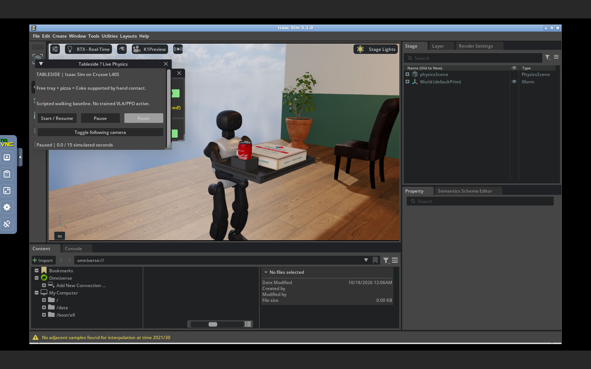

# Live Isaac Sim desktop

The L40S runs the actual Isaac Sim 5.1 GUI and free hand-contact café scene. Browser input travels through noVNC and an SSH tunnel. This is an interactive physics session, not video playback.

On the project Mac, open:

http://localhost:16080/vnc.html?autoconnect=true&resize=scale

The **Tableside — Live Physics** panel has Start / Resume, Pause, Reset and Toggle following camera controls. A run contains two seconds standing, eleven seconds walking and two seconds stopping. Reset returns the robot and free payload to their initial states. The default following camera keeps the robot in view; switch it off to inspect the scene with Isaac's viewport controls. The session starts paused.

The robot uses the verified baseline walking actor and arm gravity/load compensation. PPO and VLA are not active in this view. It is an interactive demonstration, not a scored delivery trial. Physics may run slower than wall time over the remote desktop; the panel shows simulated seconds.

Remote services bind only to loopback. The browser link works on the Mac holding the SSH tunnel. Runtime logs are under `/home/ubuntu/workspace/k1-runtime/live-desktop-01/`. `isaac.log` prints `TABLESIDE_LIVE_READY` after the scene and controls are initialized. The VM remains available through the authorized demo window.

Launch the remote desktop with `bash tools/start_isaac_desktop.sh` on the prepared VM. It requires Xvfb, Openbox, x11vnc, noVNC and websockify. The launcher reuses live processes rather than starting duplicates. Forward local TCP16080 to remote loopback6080 over the existing authenticated SSH connection. No VNC port needs public exposure.
