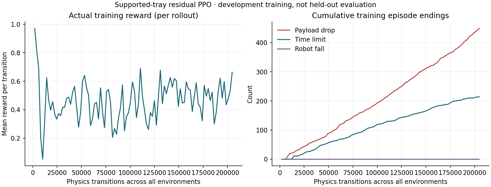

# Residual PPO: 100 actual training iterations

32 loaded K1 instances in Isaac Sim / PhysX on the authorized L40S.
Seed 7102, 64 transitions per environment per iteration, 100 iterations:
**204,800 environment transitions and 1,600 optimizer updates**. Training loop
time was 293.295 seconds, excluding startup/conversion. The run starts from a
new zero-mean residual; it does not resume or concatenate the small pilot.

The original K1 actor is frozen and its checkpoint hash is unchanged. The new
residual changes joint targets by at most ±0.08 rad. No VLA is trained. Rewards
use privileged true velocity, root height and payload poses; actor and critic
use only deployable IMU/joint/command signals and previous residuals.

During exploration, 663 episodes ended: 449 payload drops, 214 time limits and
zero robot-fall terminations. These are training events, not held-out success
rates; time-limit completion does not prove stable carrying or delivery.
The final rollout mean reward was 0.6631. The un-smoothed plot includes every
recorded iteration, including regressions. No improvement claim follows from
the training curve alone.

Independent checkpoint verification found actor parameter L2 change 2.416991,
critic change 14.385079, combined change 14.586975. Initial/final parameter hashes
and checkpoint hashes are in manifest.json. Metrics row counts and cumulative
optimizer/environment steps were independently reconciled. All 32 robot masses
and both free payload masses per instance were checked before collecting data.

Reproduce this figure with `evaluation/plot_carrying_training.py`; its provenance
JSON hashes the input, script and output. Plotting uses matplotlib 3.10.7 in an
isolated local environment. There is no smoothing or inferred evaluation rate.

The training floor is separate from the rendered development café. Each episode
requests two seconds standing, four moving at a sampled 0.30–0.40 m/s, then two
stopping. Payload mass, geometry and support are fixed provisional assumptions.
The café comparison uses the final checkpoint selected by the predeclared
100-iteration budget, not the best-looking intermediate snapshot.

Original remote: `/home/ubuntu/workspace/k1-runtime/evidence/k1-ppo-02`.
Weights and optimizer states remain there outside Git. Local evidence/source
archives: `runs/brev-k1-20261017/k1-ppo-02-{evidence,source}.tar.gz`.
The next experiment checks the final policy in a continuous rendered café run;
it remains a development diagnostic, not held-out or hardware validation.
