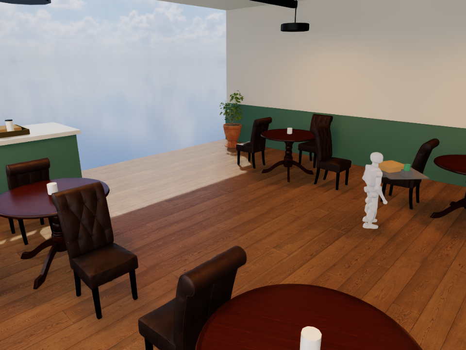

# Cup holder baseline: retained drink, excessive payload movement

Hypothesis: a physical holder will prevent the drink dropping from the supported
tray. This is a new mechanical fixture, not a learned-controller improvement.
Four rigid walls add 0.08 kg to the torso-mounted tray/bracket; the drink remains
a free dynamic body with 5 mm radial clearance. The box is unrestrained. There
is no hand grasp, liquid simulation, autonomous loading or vision guidance.

The unchanged official K1 actor ran the same 15-second scripted command in the
Isaac café: stand for two seconds, command 0.35 m/s until second 13, then stop.
Payload masses remain 0.8 kg box and 0.5 kg drink. Robot plus attachment mass was
20.696 kg, excluding these free payloads. Configuration, exact source hashes and
checkpoint identity are in manifest.json. No training occurred in this run.

Measured outcome: 15 seconds completed, 2.96937 m forward displacement, no drop,
3.62893 degrees peak body tilt, 0.00958 m/s final root speed. Maximum horizontal
payload movement was **8.419 cm**, exceeding the unchanged 4 cm threshold.
Therefore **development stability failed**. Retaining the drink alone is not
stable carrying. This is one development trial, not a success-rate estimate.

The matched trained-controller run is in
[the transfer report](../codex-20261017T2124-cupholder-ppo-transfer/REPORT.md).

Raw videos and trajectories are excluded from Git. Original remote directory:
`/home/ubuntu/workspace/k1-runtime/evidence/k1-cupholder-01`.
Local archive: `runs/brev-k1-20261017/k1-cupholder-01-evidence.tar.gz`.
Artifact hashes are in manifest.json. Each video has 375 frames at 25 fps;
trajectory recording contains 750 samples at 50 Hz. Converted USD intermediates
remain remote and are not included in the downloaded archive.
