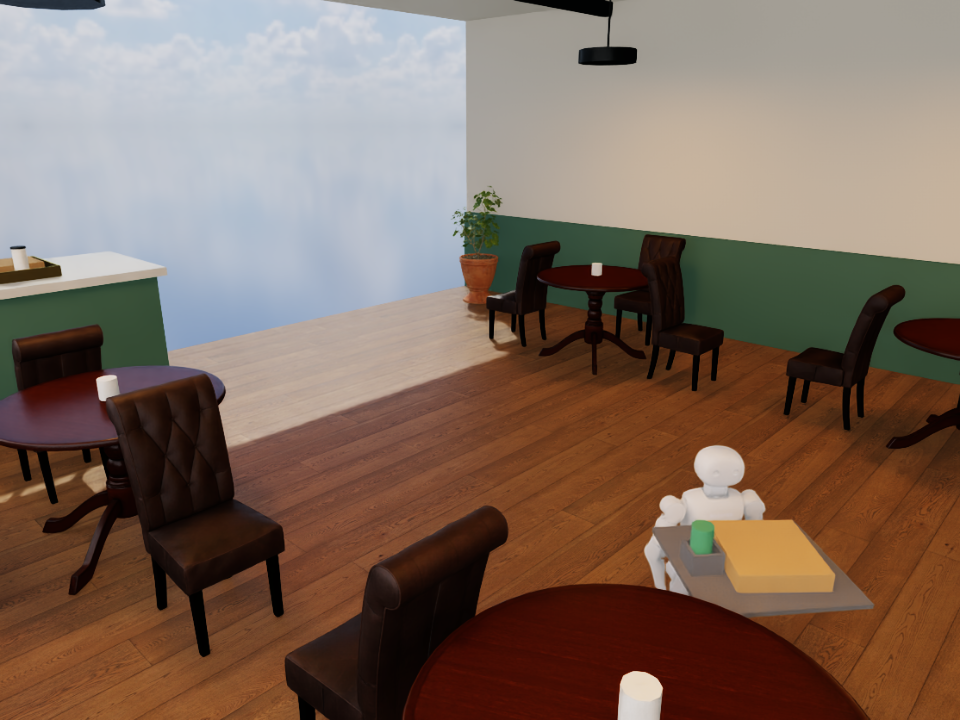

# PPO transfer to cup holder: one scripted stability pass

The final PPO02 residual, trained on the original tray without a holder, was
evaluated unchanged on the new cup-holder fixture. No additional training or
checkpoint selection occurred. This tests transfer to an explicitly modified
mechanical setup; the original no-holder failures remain valid.

The holder, payloads, café, initial condition and velocity schedule match the
[unchanged-policy baseline](../codex-20261017T2120-cupholder-baseline/REPORT.md).
Four fixed walls add 0.08 kg; the drink remains free inside them, with 5 mm radial
clearance. The box remains unrestrained. No liquid, grasp or loading is modeled.

| Measured quantity | Frozen walking actor | Actor plus PPO02 residual |
| --- | ---: | ---: |
| Simulated duration | 15 s | 15 s |
| Forward displacement | 2.96937 m | 3.55766 m |
| Payload drop | No | No |
| Maximum payload horizontal movement | 8.419 cm | 3.311 cm |
| Peak body/tray tilt | 3.629 degrees | 4.220 degrees |
| Final root speed | 0.00958 m/s | 0.01756 m/s |
| Development stability | Fail | Pass |

The thresholds were unchanged: maximum payload movement 4 cm, body/tray tilt
10 degrees, final root speed 0.05 m/s, no fall or drop. The trained run meets
those thresholds. **This is one successful scripted carrying trial**, not a
held-out comparison, camera-guided delivery, repeatability result or hardware
validation. The camera records the scene but does not guide this controller.
The mechanical holder contributed to drink retention in both runs; its effect
must not be credited solely to PPO.

PPO02 used 204,800 transitions and 1,600 optimizer updates in 32 simulated
environments. The official walking actor stayed frozen; a new bounded residual
was trained. Residual checkpoint SHA256:
`1fd6e0242a33e2c62db822cb060a88faa629d7786023a8ba96cb7f791cc746dc`.
All inputs, source hashes, physics assumptions and masses are in manifest.json.

Each continuous video has 375 frames at 25 fps. Root/payload trajectories contain
750 samples at 50 Hz. Raw recordings are excluded from Git and retained at
`/home/ubuntu/workspace/k1-runtime/evidence/k1-cupholder-ppo02-01`, with local
archive `runs/brev-k1-20261017/k1-cupholder-ppo02-01-evidence.tar.gz`.
The matching source archive is `k1-cupholder-ppo02-01-source.tar.gz` in the same
local runs directory. Artifact hashes are recorded in manifest.json; converted
USD intermediates remain remote and are excluded from the local archive.
