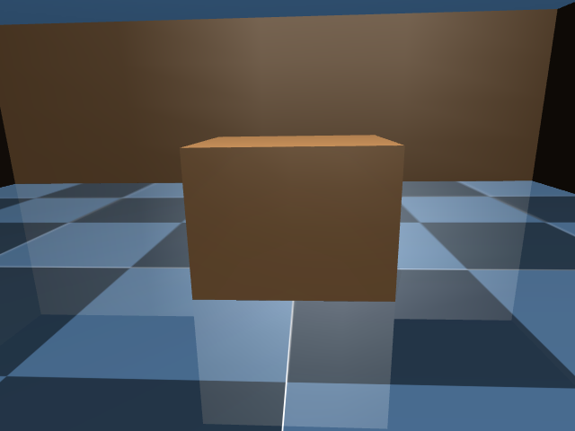

# Sensor-estimated navigation: localized, but false table blocked delivery

Actual MuJoCo K1 walking controlled by the camera-based executive, with the
unchanged official walking actor. The scene has one unnumbered table and physical
walls. No placards, segmentation labels, payload or VLA are used. The geometric
floor plan and initial pose (0,0,0), with declared uncertainty, are operator priors.
This is a development scene, not the realistic Isaac café or a held-out task.

Camera pixels come from rendering. Camera extrinsics use head joint encoders,
gyro-integrated roll/pitch and provisional leg-kinematic height. Localization
combines commanded translation, integrated gyro increments and depth-to-map scan
matching. The failed leg-velocity estimate is excluded. Root pose and velocity
are read separately for evaluation, never passed into navigation observations.
The existing walking actor uses its usual emulated IMU and joint inputs.

The executive recognized a table and began approaching at 2.4 seconds, then
reported **ambiguous_destination at 9.6 seconds**. It believed that table#0 and
table#3 both matched the instruction. The run ended at 10.98 seconds after command
ramp-down; measured final speed was 0.07933 m/s, so a physically stable stop is
not established. **No delivery occurred.**

Measured localization error: maximum XY 0.09741 m, final XY 0.02482 m, maximum yaw
0.02952 rad. Peak body tilt was 4.27477 degrees. These measurements cover this
single short run, not general localization accuracy or calibrated confidence.

Follow-up capture with otherwise identical code behavior reproduced the failure
and located the false table near a wall corner; see
[the captured diagnostic](../codex-20261017T2141-sensor-navigation-capture/REPORT.md).
The ambiguity check was retained, not bypassed.

Manifests contain source/checkpoint/artifact hashes. The exact executed source
snapshot is `runs/sensor-navigation-01-source.tar.gz`. Raw videos, trajectory and
localization records remain locally in this experiment directory outside Git.
Both videos have 55 frames at 5 fps, recorded at simulation timestamps 0–10.8 s.
The final PNG is the last recorded frame, not an image of the terminal instant.
The manifest's historical `actor_privileged_inputs` field describes the navigation
path only; the later runner names it `navigation_privileged_inputs` to avoid
implying an audit of every upstream controller internal.

The renderer warned that ARB_clip_control was unavailable and depth precision
was limited. Noise/bias, ideal encoders, flat-floor stance and initial level
attitude are declared assumptions. No hardware calibration claim is made.
