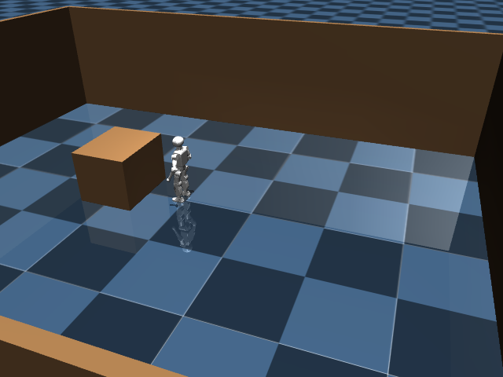

# One unloaded camera-guided approach with estimated localization

The actual MuJoCo K1 reached the single unnumbered table and the executive
reported delivery at 19.0 simulated seconds. This is one development trial,
with no payload, VLA, learned carrying residual or hardware involved.

The preceding trial stopped because a wall corner was detected as another
table. The only behavioral change here is the tabletop detector's rejection
of clusters with substantial geometry above their candidate surface. The
negative trials remain in the 2140 and 2141 experiment directories.
The exact detector SHA256 is
`1399a2071d4e7411b162c00c7fa4f4fef9b237ba1cfd7dfafabf65a5b202379f`.

| Measurement | Result |
| --- | ---: |
| Executive outcome | Delivered |
| Physical simulated duration | 19.0 s |
| Final distance to table front edge | 0.5403 m |
| Final true XY speed | 0.00124 m/s |
| Maximum true XY speed in final 1.5 s | 0.01300 m/s |
| Net XY drift in final 1.5 s | 0.00558 m |
| Maximum localization XY error | 0.09741 m |
| Final localization XY error | 0.04814 m |
| Maximum heading error | 0.02952 rad |
| Peak body tilt | 4.275 degrees |
| Collisions | Not instrumented; count unknown |

Navigation used rendered RGB-D, encoder-derived camera geometry, integrated
500 Hz gyro heading and depth scan matching. It received an operator-supplied
geometric floor plan and initial pose prior. Translation prediction still uses
commanded velocity; this run does not validate it across layouts. Simulator
world pose and velocity are evaluation-only. There are no destination signs or
object masks. Ground-truth speed was not used for the executive's stop decision.

The executive entered approach at 2.4 s, final approach at 11.2 s, settle at
14.8 s and done at 19.0 s. The 951 trajectory samples and 96 RGB-D frames are
retained locally in this experiment directory, excluded from Git. Videos have
96 frames at 5 fps: 19.2 s playback, including the final frame hold; timestamps
span 0–19.0 physical simulated seconds. The renderer reported limited depth
precision on this local OpenGL backend.

All 107 recorded artifact hashes and 15 executed-source hashes were verified.
The historical source snapshot is `runs/sensor-navigation-surface-fix-source.tar.gz`.
`evaluation_summary.json` adds descriptive stop measurements after the run;
it does not introduce a new success threshold. No success rate, robustness or
loaded delivery claim follows from this single attempt.
