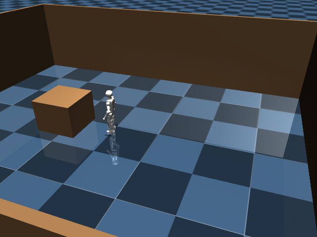

# Ten varied sensor-guided teacher trials: four completed, six timed out

The frozen collection protocol varied the table location, starting lateral
position, starting heading and gyro noise seed. Two validation episodes also
used a different table size and height. All ten attempts ran; four reached the
executive's delivered state and six timed out at 40 simulated seconds. One
timeout included room-object contact. This is an unloaded development data
collection, not an evaluation of a trained VLA or robust delivery system.

| Episode | Split | Outcome | Final localization XY error | Room contact |
| --- | --- | --- | ---: | --- |
| train-00 | Train | Timeout | 2.303 m | No |
| train-01 | Train | Delivered | 0.064 m | No |
| train-02 | Train | Timeout | 1.250 m | No |
| train-03 | Train | Timeout | 1.809 m | Yes |
| train-04 | Train | Delivered | 0.021 m | No |
| train-05 | Train | Timeout | 3.373 m | No |
| train-06 | Train | Timeout | 1.457 m | No |
| train-07 | Train | Delivered | 0.025 m | No |
| validation-00 | Validation | Delivered | 0.047 m | No |
| validation-01 | Validation | Timeout | 3.619 m | No |

The four delivered runs ended 0.508–0.638 m before the table's front edge,
within 0.124 m laterally of its center, with true final XY speeds below
0.001 m/s. These are independent evaluator measurements, not policy inputs.
The six failures remain in the denominator and archive. Translation drift
from commanded-motion prediction is the main limitation exposed by variation.
Contact accounting checks room-object versus robot contact at each 500 Hz
physics step; it does not score self-contact. The contact trial had 99 physics
steps with contact, not 99 separate collisions.

The teacher used RGB-D tabletop detection, gyro heading, encoder-derived
camera geometry, scan matching, explicit memory and an operator-supplied floor
plan/initial pose. No privileged pose, object mask or destination marker entered
the executive or recorded VLA input. The official walking actor was unchanged.
There was no payload, residual controller or VLA in these collection runs.

The frozen inclusion rule admitted successful, contact-free, sensor-only
episodes. Three training episodes provide **262 frames**; one validation
episode provides **149 frames**, all at 5 Hz. Splits are by whole episode, and
normalization uses training rows only. Failed episodes supply no training rows.
The model input is head RGB, the existing 16-dimensional estimated state and
instruction plus memory text. Labels are the executive's bounded five-dimensional
local subgoals. Future action chunks stop at episode boundaries and mask padding.
This tiny dataset is suitable for a training-pipeline pilot, not a reliability
claim. Offline imitation metrics on one successful validation episode do not
measure success across the full validation distribution.

The protocol was frozen before collection in `training/SENSOR_DEMO_PROTOCOL.json`
and is copied into `collection.json`. It fixes a 200-update, batch-four pilot;
no VLA training occurred during collection. All 1,791 recorded artifact hashes
were verified. Ten manifests and final evaluator/head-camera frames are retained
here. Full RGB-D, videos, trajectories and demonstrations remain in ignored
`runs/sensor-demos-01/`; executed source is archived in
`runs/sensor-demos-01-source.tar.gz`. Packed data is under
`runs/sensor-dataset-01/`, and its manifest is copied here as `dataset.json`.
The same packed data was uploaded to the authorized L40S in
`/home/ubuntu/workspace/k1-runtime/smolvla-train-01-input/sensor-dataset-01`.
