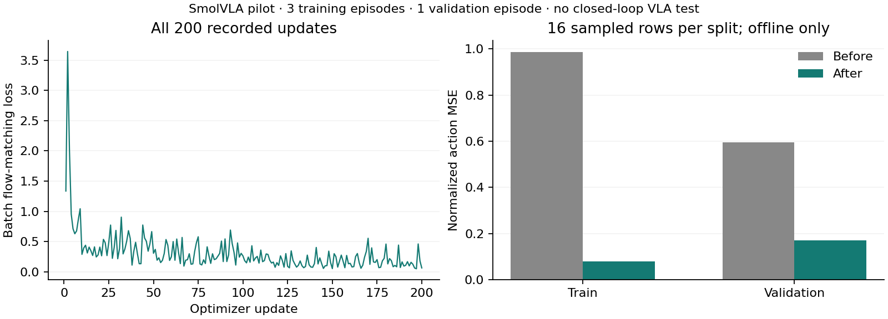

# SmolVLA: 200 actual imitation-learning updates

The pinned public SmolVLA action expert and projections were fine-tuned on
recorded sensor-only K1 simulator demonstrations. **200 optimizer updates
completed on the L40S.** The saved model changed 122 parameter tensors;
the frozen vision-language backbone's hash remained identical. This establishes
actual VLA fine-tuning, not a completed robot-delivery capability.

The [ten-attempt collection](../codex-20261017T2210-sensor-demo-pilot/REPORT.md)
produced three qualified training episodes (262 frames) and one validation
episode (149 frames). Six failed attempts were retained and excluded from the
training rows. All examples are unloaded, in a simple MuJoCo room. There is no
realistic-café or physical-robot VLA training data in this pilot.

Inputs are one head RGB image, the 16-dimensional estimated state and instruction
plus memory text. Targets are normalized five-dimensional local subgoals, in
10-frame chunks at 5 Hz with episode-end padding masked. Ground-truth simulator
poses do not enter the model. State normalization uses training episodes only.

| Training measurement | Result |
| --- | ---: |
| Total / trainable parameters | 450,046,176 / 99,880,992 |
| Optimizer updates | 200 |
| Batch size / learning rate | 4 / 0.0001 |
| Training seed | 8601 |
| Update-loop time | 20.264 s |
| Total job time, including load/evaluation/save | 45.838 s |
| Peak allocated GPU memory during training | 2.089 GB |
| Changed parameter tensors | 122 |
| Trainable-weight L2 change | 7.3128 |
| Frozen weights unchanged | Yes, full parameter hash |

The optimizer was AdamW with betas (0.9, 0.95), weight decay 0.01 and gradient
norm clipping at 10. The update budget and split were fixed before collection.
The final checkpoint was used; validation did not select a checkpoint.

| Offline metric, 16 sampled rows per split | Before | After |
| --- | ---: | ---: |
| Training flow-matching loss | 1.3961 | 0.1759 |
| Validation flow-matching loss | 0.9927 | 0.2554 |
| Training first-action normalized MSE | 0.9864 | 0.0779 |
| Validation first-action normalized MSE | 0.5953 | 0.1690 |



Evaluation used the same evenly spaced rows and fixed random seed before and
after training. These are offline imitation measurements on a tiny dataset,
not delivery success, calibrated confidence or a robustness result. The trained
VLA has not yet controlled a closed-loop K1 trial or been compared against the
executive-only baseline in navigation.

Attempt01 failed before any updates because NumPy cannot directly serialize
bfloat16 tensors for hashing. Its manifest and empty metrics remain under
`failed-hash-attempt/`. Attempt02 hashes raw tensor bytes, including dtype and
shape, and ran with the same data and budget. All 200 metric rows, the executed
source hash, dataset hash and saved checkpoint hashes were verified. A separate
strict reload reproduced both trainable/frozen hashes and produced finite
1 × 10 × 5 actions from a recorded validation frame. Its first inference took
0.454 s; this is a reload check, not a deployment latency benchmark.

Checkpoint SHA256:
`ca7e0eb430bc5896ee0639a880a3cef05f4fb0a684bb72a7c4f57ecce1907f53`.
Full initial/final trainable and frozen hashes are in `manifest.json`.
Weights remain outside Git at
`/home/ubuntu/workspace/k1-runtime/evidence/smolvla-train-02/policy/`.
The source/data packages are retained under
`runs/brev-k1-20261017/smolvla-train-0{1,2}-source-data.tar.gz`;
02 contains corrected training source and reuses 01's unchanged dataset.

Reproduction command on the prepared VM:

```sh
source /home/ubuntu/workspace/k1-runtime/.venv-smolvla/bin/activate
HF_HUB_OFFLINE=1 TRANSFORMERS_OFFLINE=1 WANDB_MODE=disabled \
python training/finetune_smolvla.py \
  --runtime /home/ubuntu/workspace/k1-runtime \
  --dataset /home/ubuntu/workspace/k1-runtime/smolvla-train-01-input/sensor-dataset-01 \
  --output /path/to/new-empty-output
```
