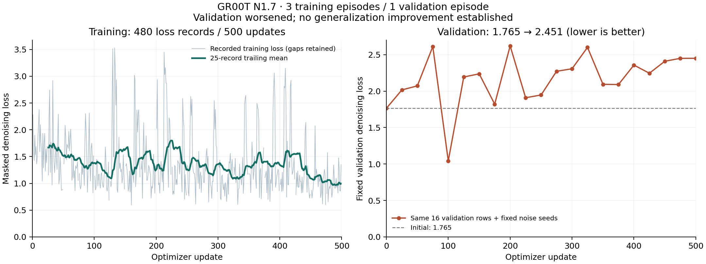

# GR00T N1.7: 500 real updates and fixed validation

The L40S run completed **500 optimizer updates** from the original GR00T checkpoint. Trainable weights changed, frozen backbone weights did not, and a strict reload of the three saved shards returned a finite action tensor of shape [1,10,5]. This establishes training and saved-model inference, not a delivery improvement.

Fixed validation loss rose from **1.76469 to 2.45072 (+38.9%; lower is better)**. The first 50 recorded training losses averaged 1.59728; the last 50 averaged 1.01740. Training fit improved while validation worsened. There is no evidence of generalization improvement or closed-loop delivery benefit. The temporary lower validation value at update100 was not used for checkpoint selection; only the final checkpoint was retained.

## Protocol and audit

Three training episodes (262 frames), one separate validation episode (149 frames); batch1, learning rate0.0001, seed9301. The official source is pinned to dac54b313160c201c450f97df0fd74ebd379c892. The validation set uses 16 evenly spaced rows, fixed noise seeds and deterministic evaluation transforms. Validation reuses the unchanged training processor statistics; the loader-required validation metadata is not merged into normalization. Python, NumPy and Torch RNG states are restored after evaluation. No validation optimizer updates occur.

Validation ran at update0 and every25 updates through500 (21 evaluations). A callback logging bug suppressed the training-loss log at multiples of25: **480 training-loss records exist for 500 actual optimizer updates**. The following logged value can average two updates. The graph retains missing entries and labels smoothing as a 25-record mean. It never invents missing losses. A corrected logger is being checked in a separate fresh run; it does not alter this evidence.

Training/audit/save took335.08s and peaked at38,528,165,888 allocated GPU bytes. There were1,620,515,968 trainable parameters and1,523,500,032 frozen parameters. See manifest.json for before/after fingerprints, dataset identity and checkpoint hashes. Reload verified all three shards and returned a finite output in0.33284s for the first recorded-frame inference. That timing is one GPU inference, not a deployment latency distribution.

Attempt01 failed before training because validation metadata was missing; attempt01_failure.json is retained. Attempt02 is the completed run. Its executed source snapshots match source hashes. The duplicate final checkpoint shards were byte-hash verified and hard-linked to reclaim disk space without deleting either checkpoint path; see deduplication_receipt.json.

Raw weights remain on the authorized Brev VM under `/home/ubuntu/workspace/k1-runtime/evidence/groot-curve-02/checkpoint`. Metrics were logged to the private [W&B run](https://wandb.ai/kaushik-siva88/k1-meal-delivery-20261017/runs/groot-curve-02). Public review artifacts contain no model weights, credentials or raw datasets. Reproduce the figure with `evaluation/plot_groot_training.py` and Matplotlib3.10.7. The simulator delivery controller does not use this checkpoint.
