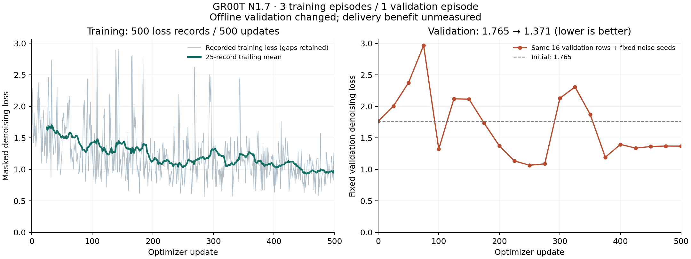

# GR00T repeat with complete per-update logging

This fresh run completed500 optimizer updates, with **500 recorded training losses and21 fixed validation evaluations**. It starts from the same original checkpoint and uses the same data, learning rate and declared seed as attempt02. The validation logger now preserves the training-log flag. Only the final model is saved, avoiding a duplicate12.6GB checkpoint.

Fixed validation loss changed from1.76469 to1.37060 (**22.3% lower**). The first50 training-loss records averaged1.58758 and the last50 averaged0.98274. This is an offline imitation result on one previously used validation episode. It does not establish delivery improvement.

The preceding500-update run worsened validation to2.45072. Both runs are retained. Their common initialization/seed did not produce identical optimization trajectories; training reproducibility is not established. The repeat was initiated to repair missing training logs, not selected after searching for a better validation result. The two outcomes should be reported together rather than treating the favorable repeat as a reliable gain.

The audited manifest verifies trainable weights changed and frozen weights did not. Runtime270.13s; peakallocatedGPUmemory38,528,165,888bytes. Executed source snapshots match the recorded hashes. Strict reload verified all three checkpoint shards and produced a finite [1,10,5] action tensor in0.39295s for one recorded frame. Its first attempt failed on an offline-mode metadata lookup before model inference; the successful retry used the already authorized Hugging Face access.

[Original protocol and negative result](../REPORT.md). Raw checkpoint remains on the Brev VM at `/home/ubuntu/workspace/k1-runtime/evidence/groot-curve-03/checkpoint`; metrics are also in the private W&B run `groot-curve-03`. No trained-controller delivery claim.
