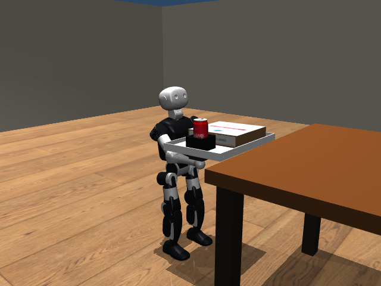

# Printed payload, physical table and camera-guided delivery

The updated MuJoCo scene includes the same Domino’s-style box and Coke textures used in Isaac, a wood floor and a physical tabletop with four legs. Attempt02 delivered at65.6s and then settled for2s. It had no room collision, fall, payload drop or non-hand robot support. Maximum payload movement6.53mm, tray tilt5.83°, arm effort7.65Nm/14Nm, longest hand-contact losses4ms/2ms. Final root-to-table-front distance0.598m and lateral error1.77cm; last1.5s maximum speed0.000932m/s.

**The first60s trial timed out.** It entered final approach late. Attempt02 explicitly extended the development budget to90s and completed at67.6s including settling. It is not a pass under the original60s limit. Source snapshots and both attempts are preserved. No controller parameters changed between these two runs.

The printed geometry adds no mass or collision response. A regression check proves exact body masses, inertias, original contacts and100 physics steps match the undecorated payload. The physical table shape is a real environment change: its top and four legs replace the former solid box; the operator map conservatively occupies its full footprint. That map/depth mismatch and sparse localization observations need further work. Payload remains free, without welds or pose replay. This is camera-guided executive control, not VLA/PPO control or hardware delivery.

The full evaluator/head videos are local ignored artifacts, with hashes in each manifest. Attempt02 contains1691frames at25fps (67.64s), covering simulation0–67.6s. `attempt02/evaluator_final_18s.mp4` is a continuous real-time excerpt starting49s into the original, with no speed change. Its provenance is in excerpt.json. Every run artifact was hash-verified before publication.

Textures reuse the reference research and provenance in sim/assets/payload/README.md. The brand artwork is approximate; the can is sealed and rigid, with no fluid simulation. A physical K1 has not been tested.

Reproduce with sim/run_k1_sensor_navigation.py using --hand-carried --printed-payload --cafe-style --known-load-depth-mask --carry-command-guard --walk-speed .4 --head-pitch -.2 --prediction-scale .5 --settle-seconds 2 --video-fps 25 and --tracking-evaluator. Set --duration 60 for attempt01 or --duration 90 for the declared longer diagnostic. Use a new output directory.
