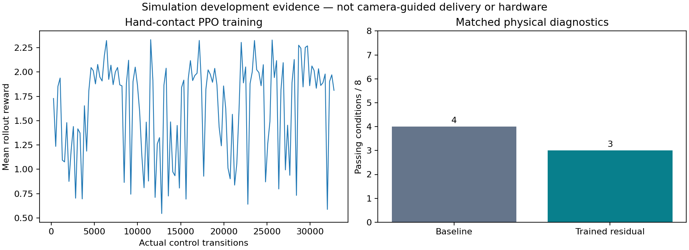

# Fresh PPO residual for hand-supported carrying

**Training completed, but the residual regressed: 3/8 diagnostic conditions passed versus 4/8 for the baseline.** It is not enabled in the live Isaac demonstration or promoted to the delivery controller.

The fresh policy collected 32,768 actual MuJoCo control transitions, comprising 327,680 physics steps, and performed 1,024 optimizer updates in 77.6 seconds on the Mac CPU. There were 81 completed training episodes, including one early termination. The original walking actor remained byte-identical. Initial and final residual parameters differ; strict checkpoint loading and a finite bounded action were verified. This policy does not reuse the earlier torso-fixture PPO weights.

The 65-value actor observation contains gyro, quaternion-derived gravity, commanded velocity, physical joint positions/velocities and the previous residual. World translation, absolute heading, linear velocity and payload state are excluded. The simulator supplies ideal proprioceptive signals; sensor noise and hardware inference are not validated here. True velocity, root height, body tilt and payload displacement affect reward or termination only. Twelve leg targets receive residuals bounded to ±0.08 rad. The existing torque-limited arm controller supports the free tray through contact.

The evaluation protocol was frozen before optimization. Sixteen eight-second physical runs compare the same initial pose and command in each mode. Gates require actual yaw or forward progress, hand-only support, payload stability and a stable final second; simply standing still cannot pass a commanded turn.

| Command during the four-second movement phase | Baseline | Trained residual |
|---|---|---|
| Stand | Pass | Pass |
| Yaw −0.18 rad/s | Fail | Fail |
| Yaw +0.18 rad/s | Fail | Fail |
| Yaw −0.22 rad/s | Fail | Fail |
| Yaw +0.22 rad/s | Fail | Fail |
| Forward 0.4 m/s command | Pass | Pass |
| Forward + yaw −0.12 rad/s | Pass | Fail |
| Forward + yaw +0.12 rad/s | Pass | Pass |

The trained controller increased pure-turn translation to approximately 2.19–2.33 m, compared with 1.76–1.88 m for the baseline. Both failed the 0.20 m translation bound and stable-stop checks in all four pure-turn conditions. The negative combined-motion condition additionally failed stopping with the trained policy. No matched evaluation run dropped the payload, but several used brief non-hand arm contact or exceeded the tray-tilt limit.

Reward is a training signal, not a delivery success metric. This small, fixed-payload development comparison is neither camera-guided delivery nor hardware validation. All failures are retained. Hashes verify the checkpoint, six executed source files, the prospective protocol and all sixteen physical trajectories. Raw weights remain in ignored `runs/hand-ppo-01/`; matched trajectories remain in `runs/hand-ppo-eval-01/`. The W&B import is explicitly retrospective.

[W&B run with all 128 training records and matched evaluation totals](https://wandb.ai/kaushik-siva88/k1-meal-delivery-20261017/runs/hand-ppo-01-historical) is API-verified finished. The project is private; sign in to view it. `wandb_receipt.json` records hashes matching the published local evidence.
