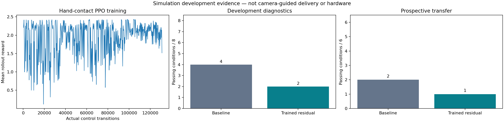

# Hand PPO02: smaller turning drift, lower overall pass counts

A fresh bounded 12-leg-joint residual trained for **131,072 actual MuJoCo control transitions**, **1,310,720 physics steps** and **4,096 optimizer updates**. The base walking actor stayed frozen. Seed9802;327 completed episodes including2 early terminations;369.28s CPU training. No GR00T training occurred in this experiment. No deployment to live Isaac.

The new explicit `velocity_v2` reward replaces saturated exponential velocity/yaw tracking with quadratic errors and penalizes contact between the tray and non-hand robot links. The prior `tracking_v1` reward remains the default. Truth velocity/contact state is reward/evaluation-only; the residual still observes gyro, gravity direction, commanded velocity,22 encoders/velocities and previous residuals. Residual targets remain bounded to±0.08rad. No privileged root position or linear velocity enters the actor.

| Diagnostic set | Baseline | Trained residual |
| --- | ---: | ---: |
| Existing8 development conditions |4/8 |2/8 |
| Six additional prospective conditions |2/6 |1/6 |

The additional protocol was frozen while training was still running. It changes initial yaw to0.31rad and uses six command combinations outside the exact training combinations. It is a small prospective diagnostic, not broad held-out delivery reliability. Previous development failures informed the reward; seed, reward and training budget differ from PPO01, so this experiment does not isolate one causal training change.

Across the four development pure-turn cases, maximum translation fell from1.757–1.877m to0.110–0.241m. Three of four now pass the0.2m translation limit, and all four pass hand-only support and tray tilt checks. **None passes every gate:** stopping exceeds the0.03m/s final-second bound, and the+0.22rad/s case also exceeds the translation limit. Straight walking fails the stable-stop criterion; one forward-turn case exceeds tray tilt. In the prospective set, the0.35m/s forward/negative-turn trial terminates early with a fall/drop gate failure. Full criterion-by-criterion results are retained.

Do not promote this checkpoint as a better delivery controller. Lower turning drift is a component improvement, while overall acceptance regressed. The live GR00T/Isaac demo retains its existing baseline gait. Next work should address stopping and preserve baseline straight walking, then rerun physical checks and cross-simulator evaluation before live use. No camera-guided delivery or hardware success is established here.

Validation: all512 measured metric rows retained; strict checkpoint reload and finite-parameter/action checks passed; six source snapshots and all28 evaluation trajectory hashes verified. Both prior baseline turning trajectories are bit-identical with the new diagnostic constructor defaults. Existing hand-controller/residual tests:3 passed. Weights and raw trajectories remain under ignored runs/hand-ppo-02, runs/hand-ppo-eval-02 and runs/hand-ppo-transfer-02. Checkpoint SHA256:`6f0429398cdc60ccbe980e75a3dc680cacf1fd72b9ade0fd2fbe6574b691667a`. Parameter change L2:17.291965; unchanged base actor hash recorded in manifest.

Reproduce training: `sim/.venv/bin/python -m training.train_hand_carrying --output NEW_DIR --iterations 512 --horizon 256 --reward-version velocity_v2 --seed 9802`. Evaluate with `evaluation.evaluate_hand_residual`, first using evaluation/HAND_PPO_PROTOCOL.json, then evaluation/HAND_PPO_TRANSFER_PROTOCOL.json. These are eight-second physical episodes with2s settling,4s motion and2s stopping.

Private W&B historical import: [hand-ppo-02-historical](https://wandb.ai/kaushik-siva88/k1-meal-delivery-20261017/runs/hand-ppo-02-historical). API-verified finished; all512 iteration/step pairs match local metrics; all6 uploaded file hashes match. The export performs no training. Initial SDK compatibility failure happened before run creation; the installed0.27.2 query path is now verified. Evaluation reward_mean uses the unchanged v1 environment reward; acceptance uses the frozen physical criteria, not reward comparisons.
